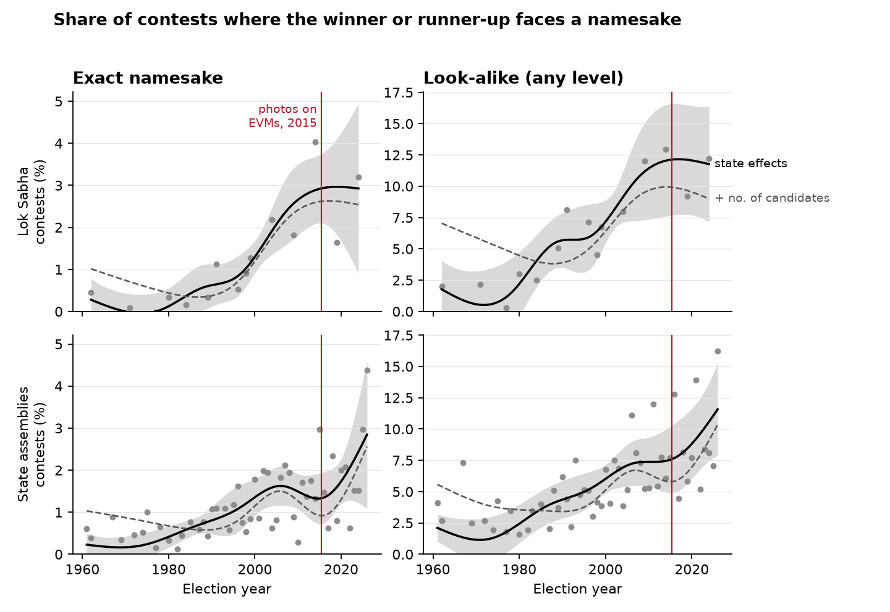

# Candidate namesakes in Indian local elections

How often a local-election candidate faced a rival whose name a voter could
mistake for theirs, in the same contest. Coverage so far: Bihar's 2016 and 2021
panchayat elections, every seat in all six offices, and Rajasthan's 2020
sarpanch elections with the by-elections of 2021-22. These are the cycles for
which the pooled [local_elections](https://github.com/in-rolls/local_elections)
tables list every candidate; earlier cycles in both states list winners only.
Tamil Nadu, Uttar Pradesh and Uttarakhand candidate tables can be added as
further inputs; each output row carries `state`.

A **contest** is one seat in one election: a gram panchayat's mukhiya, a ward,
a panchayat samiti or zila parishad constituency, a gram kachahari's sarpanch or
member seat. The quantity of interest is voter confusion, so names are compared
in three widening tiers:

- **exact namesake**: identical once case, punctuation, spacing and the State
  Election Commission's numbering are removed. The SEC writes it many ways:
  "(1)", "2", "01", "(१)", "II", "(II)", "-2", "-II", "DEVI1".
- **spelling namesake**: also identical once spellings of one spoken name are
  folded together: ी/ि, ू/ु, श/ष/स, व/ब, nukta, half-n/anusvara (सन्जय = संजय), and
  in Latin letters ee/i, oo/u, w/v/b, sh/s, aspirates, doubled letters,
  Md/Mohammad, Kr./Kumar; spaces inside a name are ignored (राज कुमार =
  राजकुमार). Suneel and Sunil, सुनील and सुनिल, Vinod and Binod count as one
  name. The fold table is in [`names.py`](src/candidate_namesakes/names.py), with
  tests in [`tests/test_names.py`](tests/test_names.py).
- **look-alike**: a spelling namesake, or one name contained in the other
  (MADAN RAY, MADAN KISHOR RAY), or names that share a word and whose remaining
  words are at least 0.7 similar by edit distance (गीता/सीता देवी, MANJU/SANJU
  DEVI, KANTI/SANTI DEVI). Shared words are set aside before measuring, because
  a common surname or "Devi" makes whole names look alike when the given names
  are nothing alike (ANIL KUMAR SINGH, NIRMAL KUMAR SINGH). See
  [Look-alike names](#look-alike-names) for how 0.7 was chosen.

## Results

<!-- summary:start -->

| State     |   Year | Office                                   | Election         |   Contests |   Mean candidates |   Exact namesake (%) |   Spelling namesake (%) |   Look-alike (%) |   Repeated records dropped |
|:----------|-------:|:-----------------------------------------|:-----------------|-----------:|------------------:|---------------------:|------------------------:|-----------------:|---------------------------:|
| Bihar     |   2016 | Ward Member (`gp_ward`)                  | not recorded     |     98,088 |               2.8 |                  0.9 |                     0.9 |              2.3 |                        107 |
| Bihar     |   2016 | Panch (`kachahari_member`)               | not recorded     |     93,019 |               1.4 |                  0.1 |                     0.2 |              0.4 |                         41 |
| Bihar     |   2016 | Panchayat Samiti Member (`block_member`) | not recorded     |     10,839 |               7.4 |                  5.3 |                     5.7 |             13.4 |                         75 |
| Bihar     |   2016 | Mukhiya (`gp_head`)                      | not recorded     |      7,995 |              12.0 |                 13.8 |                    14.6 |             26.8 |                        131 |
| Bihar     |   2016 | Sarpanch (`kachahari_head`)              | not recorded     |      7,915 |               5.7 |                  3.4 |                     3.6 |              8.6 |                         78 |
| Bihar     |   2016 | Zila Parishad Member (`zp_member`)       | not recorded     |        895 |              11.3 |                  9.9 |                    10.7 |             20.1 |                         16 |
| Bihar     |   2021 | Ward Member (`gp_ward`)                  | not recorded     |    109,583 |               4.6 |                  2.1 |                     2.8 |              5.9 |                          1 |
| Bihar     |   2021 | Panch (`kachahari_member`)               | not recorded     |    106,839 |               2.0 |                  0.3 |                     0.4 |              1.1 |                          3 |
| Bihar     |   2021 | Panchayat Samiti Member (`block_member`) | not recorded     |     11,075 |               6.7 |                  3.5 |                     4.3 |              9.9 |                          0 |
| Bihar     |   2021 | Mukhiya (`gp_head`)                      | not recorded     |      8,062 |               8.2 |                  6.2 |                     7.9 |             14.2 |                          0 |
| Bihar     |   2021 | Sarpanch (`kachahari_head`)              | not recorded     |      8,056 |               6.2 |                  3.1 |                     4.1 |              8.6 |                          1 |
| Bihar     |   2021 | Zila Parishad Member (`zp_member`)       | not recorded     |      1,158 |              11.2 |                  7.7 |                    10.1 |             18.0 |                          0 |
| Rajasthan |   2020 | Sarpanch (`gp_head`)                     | General Election |     11,300 |               6.0 |                  5.6 |                     5.9 |             13.2 |                          4 |
| Rajasthan |   2021 | Sarpanch (`gp_head`)                     | By Election      |         79 |               3.0 |                  0.0 |                     0.0 |              2.5 |                          0 |
| Rajasthan |   2021 | Sarpanch (`gp_head`)                     | General Election |         10 |               8.8 |                  0.0 |                     0.0 |             30.0 |                          0 |
| Rajasthan |   2022 | Sarpanch (`gp_head`)                     | By Election      |         56 |               3.3 |                  5.4 |                     5.4 |              7.1 |                          0 |

<!-- summary:end -->

Bihar's candidate tables come from its general elections but do not record the
election type. "Mean namesakes" counts every candidate who has a namesake: a contest with two
Sunita Devis contributes 2. A contest has a look-alike when any two of its
candidates are look-alikes. The table is written by `make build` from
[`data/release/summary.csv`](data/release/summary.csv).

Most namesakes carry very common names: सुनीता देवी, रेखा देवी, गीता देवी and
SUNITA DEVI head the list. Women's seats gather many "X Devi" candidates.

## Lok Sabha and assembly elections

Every Lok Sabha candidate from 1962 to 2024 and every state assembly
candidate from 1962 to May 2026, except five assemblies elected in December
2023 (Rajasthan, Madhya Pradesh, Chhattisgarh, Telangana, Mizoram), whose
results are not available in full (see Source). For each general-election contest, the winner's and runner-up's
lower-placed rivals are matched at each level. Contests from by-elections,
and state-years whose names TCPD prints mostly as initials and a surname
("K.N. RAO": most of 1967), are left out;
[`excluded_abbreviated.csv`](data/release/tcpd/excluded_abbreviated.csv)
lists them.



Share of general-election contests in which the winner or runner-up faces at
least one lower-placed namesake: exact (left) or at any look-alike level
(right), Lok Sabha 1962-2024 (top) and state assemblies 1961-2026 (bottom).
Solid line: a linear probability model with state fixed effects and a natural
cubic spline in election year, averaged over all contests; shading, a 95%
interval with standard errors clustered by state. Dashed line: the same model
also holding log(number of candidates) fixed. Dots: yearly shares after
removing each state's mean, for years with at least 100 contests. Red line:
the Election Commission's rule putting candidate photographs on voting
machines from 1 May 2015. The spline is least reliable at the ends of each
series. Year-by-year counts at every level, and the share of namesakes who are
independents, are in [`extent.csv`](data/release/tcpd/extent.csv); the model
predictions are in [`trend.csv`](data/release/tcpd/trend.csv).

Do leading candidates attract namesakes? Among all pairs of a leader (winner
or runner-up) and a minor candidate in the same contest, the number that are
namesakes, per 10,000 pairs, against pairs of two minor candidates. If
namesakes were coincidence the two rates would be about equal. Common names
may be commoner among leaders or among minor candidates, so a ratio above 1 is
suggestive, not proof of planting.

<!-- tcpd:start -->

| Election   | Match level   |   Leader-minor pairs (per 10,000) |   Minor-minor pairs (per 10,000) |   Ratio |
|:-----------|:--------------|----------------------------------:|---------------------------------:|--------:|
| Assembly   | exact         |                               8.1 |                              4.8 |    1.69 |
| Assembly   | spelling      |                               9.7 |                              5.4 |    1.79 |
| Assembly   | alias         |                               9.8 |                              5.4 |    1.81 |
| Assembly   | initials      |                              23.2 |                             11.1 |    2.10 |
| Assembly   | lookalike     |                              47.9 |                             27.9 |    1.72 |
| Lok Sabha  | exact         |                               7.6 |                              2.9 |    2.57 |
| Lok Sabha  | spelling      |                               8.7 |                              3.5 |    2.49 |
| Lok Sabha  | alias         |                               8.7 |                              3.5 |    2.50 |
| Lok Sabha  | initials      |                              22.0 |                              7.0 |    3.14 |
| Lok Sabha  | lookalike     |                              46.0 |                             17.1 |    2.69 |

<!-- tcpd:end -->

Checks against published accounts: Mahasamund 2014, where the BJP's Chandu Lal
Sahu won by 1,217 votes, has six other CHANDU LAL SAHUs and a CHANDOO LAL SAHU,
who polled 62,934 votes, the figure Factly reported; Hisar 2014 has six
KULDEEPs beside runner-up Kuldeep Bishnoi; Hindustan Times counted at least 23
Lok Sabha seats in 2014 with two candidates of the same full name; the parsed
names give 31.

How names are cleaned before matching, and what each source prints in the
name field, is in [docs/names.md](docs/names.md).

## Look-alike names

Two ways of judging whether a voter could mix up two names were compared on
180 within-contest pairs spread across similarity levels: edit similarity of
the words the names do not share, and a 0-3 rating from Muse Spark
(`muse-spark-1.3-contributor`; 0 clearly different, 2 easily confused at a
glance, 3 the same name). Muse rated 48 of 51 pairs above 0.7 similarity as
easily confused or the same, 11 of 16 between 0.6 and 0.7, and 10 of 70 below
0.4.
The two measures largely agree, and 0.7 is where Muse's ratings turn.

Muse also catches cases edit distance cannot: a name inside a longer one
(KRISHNA KUMAR, KRISHNA KUMAR GUPTA), now its own tier, and names split by a
space, now folded. But its ratings did not repeat well enough to replace edit
distance: re-rating 80 pairs in different batches gave the same 0-3 rating 70%
of the time (99% within one point), below the 80% set in advance.
[`rate_confusion.py`](src/candidate_namesakes/rate_confusion.py) rates the
uncertain band (similarity 0.5-0.8 and contained names; about 50,000 distinct
pairs, about $1.10); it was stopped after 2,000 pairs on that gate, and its
output is not published.

## Do look-alikes draw votes?

Bihar only: Rajasthan records votes for the winner and runner-up alone, so its
losing candidates cannot be compared. If voters mix up names, some votes meant
for a strong candidate should land on
the rival whose name resembles it. [`check_votes.py`](src/candidate_namesakes/check_votes.py)
compares candidates in the same contest: among those who did not win, how much
higher is the vote share of those whose name resembles the winner's, at each
level of resemblance, than of those whose name does not? Contest fixed effects
absorb everything a contest shares; standard errors are clustered by contest.
As a placebo the same comparison is made against the last-placed candidate,
whose votes are too few for confusion to matter.

<!-- votes:start -->

232,231 contests with every vote count recorded and one clear winner and last-placed candidate.

| Resembles             | Resemblance        |   Candidates |   Vote-share gap (points) |   Standard error |
|:----------------------|:-------------------|-------------:|--------------------------:|-----------------:|
| winner                | same name          |        2,591 |                     -0.07 |             0.18 |
| winner                | alias              |            5 |                     -2.38 |             3.29 |
| winner                | contained          |          867 |                     -0.61 |             0.37 |
| winner                | similarity 0.8+    |        1,009 |                     +0.30 |             0.31 |
| winner                | similarity 0.6-0.8 |        9,362 |                     -0.06 |             0.10 |
| winner                | similarity 0.5-0.6 |       17,213 |                     -0.21 |             0.07 |
| last-placed (placebo) | same name          |        1,929 |                     -0.01 |             0.19 |
| last-placed (placebo) | alias              |            3 |                     -5.68 |             4.56 |
| last-placed (placebo) | initials differ    |            1 |                    +11.02 |             0.00 |
| last-placed (placebo) | contained          |          711 |                     +0.06 |             0.38 |
| last-placed (placebo) | similarity 0.8+    |          786 |                     -0.51 |             0.27 |
| last-placed (placebo) | similarity 0.6-0.8 |        7,450 |                     -0.28 |             0.10 |
| last-placed (placebo) | similarity 0.5-0.6 |       13,768 |                     -0.22 |             0.07 |

<!-- votes:end -->

No level of resemblance to the winner, including an exact namesake, comes with
a detectable gain in vote share. This does not show that voters are never
confused. Namesakes planted to split a vote are likely weak candidates, while
the comparison group includes serious runners-up, so a gain of a point or two
could be hidden by that difference. By office, in
[`data/release/vote_check.csv`](data/release/vote_check.csv).

## Files

| File | Rows | Each row is |
|---|---:|---|
| [`data/release/contests.parquet`](data/release/contests.parquet) | 463,524 | a contest |
| [`data/release/namesake_candidates.parquet`](data/release/namesake_candidates.parquet) | see `MANIFEST.json` | a candidate with a spelling namesake or a look-alike |
| [`data/release/name_pairs.parquet`](data/release/name_pairs.parquet) | see `MANIFEST.json` | a pair of candidates in one contest whose names resemble each other (spelling namesakes, contained names, or similarity at least 0.5) |
| [`data/release/summary.csv`](data/release/summary.csv) | 12 | a year and office |
| [`data/release/vote_check.csv`](data/release/vote_check.csv) | 70 | an office, comparison and resemblance level |

`contests.parquet` keeps the pooled seat columns (`row_id`, `state`, `year`, `tier`,
`tier_local`, `district`, `block`, `gp_no`, `gram_panchayat`, `ward_no`,
`reserved_caste`, `reserved_woman`) and adds:

| Column | Meaning |
|---|---|
| `candidate_count` | distinct candidates, after removing repeated records |
| `duplicate_record_count` | records dropped as repeats of a candidate (see below) |
| `namesake_exact_count`, `namesake_spelling_count` | candidates who have a namesake |
| `namesake_exact_group_count`, `namesake_spelling_group_count` | distinct shared names (two Sunitas and two Rekhas = 2) |
| `has_namesake_exact`, `has_namesake_spelling` | any namesake in the contest |
| `lookalike_count`, `has_lookalike` | candidates with a look-alike; any in the contest |

`name_pairs.parquet` has `row_id`, `state`, `year`, `tier`, both candidates'
`candidate_id` and printed name (`_a`, `_b`), their spelling keys, and the
signals: `is_same_exact`, `is_same_spelling`, `is_contained`,
`differing_word_similarity` (0-1; blank when one name contains the other) and
`shares_a_word`.

`namesake_candidates.parquet` has `row_id`, `state`, `year`, `tier`, the
candidate's columns from the source (`candidate_id`, `candidate_name`,
`relation_name`, `candidate_age`, `candidate_woman`, `votes`, `elected`), the
keys (`name_exact`, `name_spelling`), the size of each namesake group and
`has_lookalike`. Join to the pooled tables on `row_id` or `candidate_id`.

## Source

Two inputs, pinned with SHA-256 in [`data/source.json`](data/source.json), both
from [in-rolls/local_elections](https://github.com/in-rolls/local_elections) at
commit `112e86b7`:

- `data/master/candidates_bihar.parquet`: 1,569,245 candidates, pooled from
  [in-rolls/local_elections_bihar](https://github.com/in-rolls/local_elections_bihar)
  (commit `ff9c616`).
- `data/master/candidates_rajasthan.parquet`: 68,202 candidates, pooled from
  [in-rolls/local_elections_rajasthan](https://github.com/in-rolls/local_elections_rajasthan).

TCPD Indian Elections Data v2.0 (Lok Dhaba, Trivedi Centre for Political
Data, Ashoka University): `All_States_GE` (91,669 Lok Sabha candidates,
1962-2019 and by-elections to 2021) and `All_States_AE` (483,565 assembly
candidates, to 2023). Cite: Agarwal, Ananay, et al. 2021. "TCPD Indian
Elections Data v2.0." Trivedi Centre for Political Data, Ashoka University. Free
for non-commercial use with citation; the files are not redistributed here.
The official download (`lokdhaba.ashoka.edu.in/downloads/All_States/`) refused
connections on 2026-11-01, so the copies were taken from a GitHub mirror of a
2026-07-26 download (`Ayush12358/electoral-reservation`); its Rajasthan and
Uttar Pradesh assembly rows match TCPD files downloaded in April 2023 except
one 1995 row TCPD has since corrected. Paths, URLs and SHA-256 are in
`data/source.json`; `make fetch` retrieves them.

After TCPD's coverage ends, results come from the Election Commission's own
publications, through three routes:

- Lok Sabha 2024: ECI Statistical Report, report 33, "Constituency Wise
  Detailed Result" (8,359 candidates in 542 seats; Surat was uncontested).
  The copy used is the one in `in-rolls/wasted_votes` (committed 2025-08-23);
  where it was downloaded from was not recorded. A second copy, scraped from
  the results site by `thecont1/india-votes-data`, agrees on 8,803 candidates;
  the rest differ in spelling (the results site cuts long names short) and
  1.2% of matched vote totals differ, so the statistical report is used.
- Assemblies of 2024-2026 (Haryana, Jharkhand, Jammu and Kashmir, Maharashtra,
  Bihar, Delhi, Assam, Kerala, Puducherry, Tamil Nadu, West Bengal):
  [`thecont1/india-votes-data`](https://github.com/thecont1/india-votes-data)
  (MIT) at commit `7d8cf63`, scraped from results.eci.gov.in; every seat of
  each election is present.
- Assemblies of June 2024 (Andhra Pradesh, Odisha, Arunachal Pradesh, Sikkim):
  the constituency pages of results.eci.gov.in as kept by the Internet
  Archive's Wayback Machine, fetched by
  [`fetch_wayback.py`](src/candidate_namesakes/fetch_wayback.py) and parsed by
  [`parse_wayback.py`](src/candidate_namesakes/parse_wayback.py), which checks
  each page's final counting round, its NOTA row and its total.
- Not covered: the December 2023 assemblies. The results site no longer serves
  them, eci.gov.in refuses scripted downloads, and the Wayback Machine holds
  only part of each (Rajasthan 124 of 199 seats, Telangana 51 of 119, Madhya
  Pradesh 44 of 230, Chhattisgarh 16 of 90, Mizoram 2 of 40). ECI's
  statistical reports for them, downloaded by hand, would close the gap.

## Prior work

Namesake and "dummy" candidates in Indian elections are well covered by
journalism and data journalism, mostly for Lok Sabha and assembly races:
counts of constituencies where top contestants faced a namesake
([Hindustan Times, 2019](https://www.pressreader.com/india/hindustan-times-st-jaipur/20190319/281526522388541)),
the motives and remedies ([The Diplomat, 2020](https://thediplomat.com/2020/12/indias-fight-against-copying-candidates/)),
whether namesakes swung close races ([Factly](https://factly.in/analysis-do-dummy-candidates-with-similar-names-affect-election-results/)),
and a fuzzy match of about 350,000 candidates from 1960 to 2023 that finds most
namesakes take under 1% of the vote ([Diagram Chasing, 2024](https://diagramchasing.fun/2024/votes-in-a-name)).
No peer-reviewed estimate of how much namesakes take from their target turned
up, and nothing on panchayat elections. The nearest causal designs are about
other ballot cues: minor candidates' votes nearly double when listed next to a
major candidate ([Shue and Luttmer 2009](https://www.hks.harvard.edu/publications/who-misvotes-effect-differential-cognition-costs-election-outcomes-0)),
and Tamil Nadu independents gain from the symbol they are assigned
([Lee, PSRM](https://www.cambridge.org/core/journals/political-science-research-and-methods/article/election-symbols-and-vote-choice-evidence-from-india/4AA674319062BDF272A3C0509374C12F)).

## Limitations

- **Repeated records in 2016.** The 2016 release repeats some candidates inside
  a contest, sometimes with their vote totals crossed between two people of the
  same name. A record with the same name, relation name and age as an earlier
  one in the contest is counted once (`duplicate_record_count`, and the last
  column of the results table). Where relation name or age is blank, records are
  never merged. Vote totals for these candidates are unreliable upstream.
- **Scripts.** Voters saw names in Devanagari. 2016 lists are 88% Latin
  transliterations, so 2016 similarity is measured on a spelling voters did not
  see. A Latin and a Devanagari spelling of one name are not matched; 64
  contests mix scripts.
- **Rajasthan names** are Latin transliterations, and many women are listed by
  given name alone (ANITA, MANJU), so common given names make exact namesakes
  more likely than full names would.
- **The 0.7 threshold** rests on 180 rated pairs and one rater. The pair table
  keeps the similarity, so other cut-offs can be applied.

## Reproduce

```sh
uv sync --group dev
make fetch        # download the pinned input and print its SHA-256
make build        # write data/release/ and MANIFEST.json (about 3 minutes)
make check-votes  # write data/release/vote_check.csv and its README table
make test
```

`MANIFEST.json` records the input and every output of `make build` with row
counts and SHA-256.
